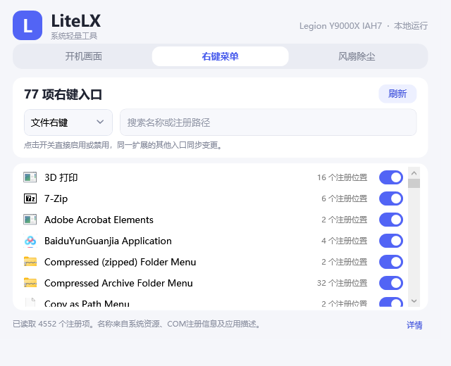
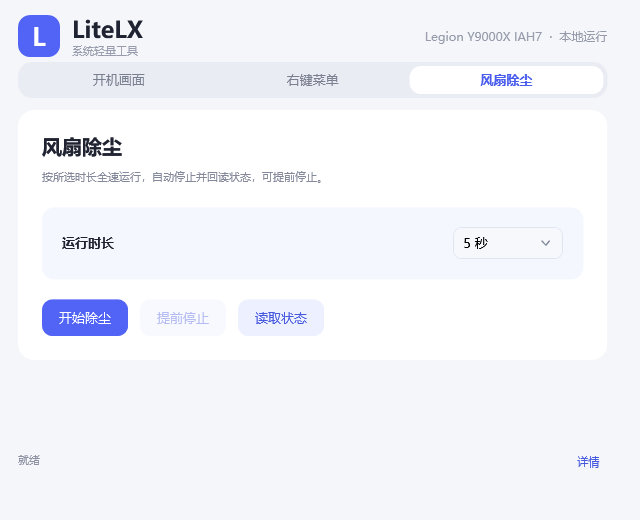

# LiteLX

从**某想电脑管家工具箱**中提取部分自用功能，重新集成到一个轻量 Windows App。

目前集成了**开机画面定制、右键菜单管理、风扇除尘**三个功能，提供统一的 WPF 图形界面和命令行入口。项目结合已提取的原厂开机画面接口、联想 WMI 接口及 Windows 原生注册表接口，便于日常使用和功能研究。

这是围绕 Lenovo 82TF 设备开发的个人自用项目。硬件相关路径限定已分析的机型和驱动版本，使用前请核对下方运行条件与验证状态。

## 功能与界面

以下截图由当前源码编译后的程序通过内置预览入口生成。机型名称、菜单条目及图片预览会随本机环境变化。

### 开机画面定制

- 选择 BMP 图片并即时预览，支持取消本次选择。
- 保存时根据固件返回的尺寸等比例准备图片，本机为 2560 × 1600。
- 提供保存和恢复默认画面入口，后台执行文件校验及状态回读。
- 保存会修改 EFI 图片和固件设置，恢复默认会清理自定义图片，重启后生效。


### 右键菜单管理

- 扫描 Windows 注册表中的右键命令及传统 COM 扩展。
- 按文件右键、桌面右键和全部注册项筛选，支持搜索名称或注册路径。
- 显示应用图标、系统本地化名称及同一入口的注册位置数量。
- 通过开关直接启用或禁用入口，同一扩展的相关入口同步更新。



### 风扇除尘

- 使用联想 WMI FullSpeed 接口进行短时全速运行。
- 可选择 5 秒、10 秒或 18 秒，支持提前停止和读取状态。
- 结束时发送停止请求并回读状态，操作结果显示在主窗口底部。



## 运行条件与验证状态

- Windows x64，已安装 .NET Framework 4.x 及 WPF 组件。
- GUI 启动时请求管理员权限，固件操作和本机风扇 WMI 接口需要该权限。
- 开机画面依赖 `modules/LenovoLogo/AIToolAPI.dll` 及构建生成的 x86 后台执行器。
- 风扇功能依赖兼容的联想驱动和 WMI 提供程序，当前硬件适配限定 Lenovo 82TF 与已核实的驱动哈希。
- 移动程序时保留项目根目录下 `build` 与 `modules` 的相邻布局。

| 功能 | 当前验证状态 |
| --- | --- |
| 开机画面 | 保存、恢复、校验失败与回读失败等模拟流程通过，实机固件写入和重启显示仍待验收 |
| 右键菜单 | 真实只读扫描及临时注册表条目的切换回归通过，实际应用菜单变更和 Explorer 显示效果仍待验收 |
| 风扇除尘 | 本机管理员权限下 WMI 5 秒启停、停止回读及独立追加查询通过，更长周期和运行中取消仍待实机验证 |
| 界面 | 三个页面及图片替换预览已验证，跨显示器实时缩放仍待现场验证 |

完整的电脑管家卸载后可用性仍待验收。旧式 EnergyDrv 风扇路径保留为 CLI 诊断选项，该路径的本机启停验收失败。详细过程见风扇测试记录与分析报告。[风扇测试记录](docs/fan-test-result.md) · [分析报告](analysis/report.md)

## 构建与启动

在 Windows PowerShell 中执行以下命令。构建脚本使用 Windows 已安装的 .NET Framework 编译器。

```powershell
git clone https://github.com/LinsamYoung/liteLXtools.git
cd liteLXtools
.\build.ps1
.\build\LiteLX.exe
```

构建后也可以双击 `build\LiteLX.exe` 启动图形界面。

| 构建产物 | 用途 |
| --- | --- |
| `build/LiteLX.exe` | x64 图形界面 |
| `build/LiteLX.Cli.exe` | x64 命令行工具 |
| `modules/LenovoLogo/LogoOperationHost.exe` | x86 开机画面后台执行器，匹配原厂 DLL |

执行已有回归测试时使用下列命令。测试覆盖模拟硬件控制、开机画面文件处理及独立临时 HKCU 菜单条目的切换。

```powershell
.\build.ps1 -Test
```

## 原厂模块提取

仓库中的 `modules/LenovoLogo` 包含已提取的 `AIToolAPI.dll` 和校验清单。脚本可从本机联想电脑管家安装目录重新提取该接口文件，按只读方式访问原安装目录，并核对 SHA-256。目标存在不同文件时会停止。

```powershell
.\tools\extract-logo.ps1
.\build.ps1
.\build\LiteLX.Cli.exe module list
```

脚本默认读取电脑管家 `5.1.210.10222` 的安装目录，也可以显式传入路径。

```powershell
.\tools\extract-logo.ps1 -InstallDirectory 'C:\Program Files (x86)\Lenovo\PCManager\5.1.210.10222'
```

## 常用命令

```powershell
# 查看 Windows 电量、驱动身份、设备映射和 WMI 类架构。
.\build\LiteLX.Cli.exe status

# 核对开机画面模块及文件校验状态。
.\build\LiteLX.Cli.exe module list

# 读取固件开机画面参数，需要管理员权限。
.\build\LiteLX.Cli.exe logo status

# 离线准备 BMP，宽高需按目标固件核对。
.\build\LiteLX.Cli.exe logo prepare 'C:\Images\logo.png' '.\prepared-logo' 2560 1600

# 只读列出右键菜单，可传入过滤词。
.\build\LiteLX.Cli.exe menu list Lenovo

# 省略 --apply 时只显示操作计划。
.\build\LiteLX.Cli.exe menu disable '<扫描结果中的ID>' --apply
.\build\LiteLX.Cli.exe menu enable '<扫描结果中的ID>' --apply

# 查询风扇状态，或查看运行计划。
.\build\LiteLX.Cli.exe fan status --confirm-hardware-query
.\build\LiteLX.Cli.exe fan plan
.\build\LiteLX.Cli.exe fan run 5
```

CLI 的真实风扇启停需要同时传入 `--execute --confirm-hardware`，运行时长支持 1 至 18 秒。`fan stop` 提供人工停止入口，启停应选择相同后端，旧式 EnergyDrv 路径通过 `--energy` 显式选择。硬件写入会真实影响设备，既有测试方案和运行记录保存在 `docs` 与 `analysis/evidence` 中。[风扇测试方案](docs/fan-test-plan.md) · [风扇测试记录](docs/fan-test-result.md)

## 项目结构

| 路径 | 内容 |
| --- | --- |
| `src/LiteLX/` | WPF 界面、CLI、菜单管理与硬件适配源码 |
| `src/LogoOperationHost.cs` | 开机画面后台执行器源码 |
| `modules/LenovoLogo/` | 原厂接口文件与校验清单 |
| `tools/` | 提取、只读采集、分析工具和回归测试 |
| `tools/vendor/` | PE 分析工具使用的 pefile、Capstone 依赖 |
| `docs/` | 功能说明、测试方案、测试记录与当前界面截图 |
| `analysis/` | 历史调查、界面记录与实机证据 |
| `build.ps1` | 构建与测试入口 |

菜单实现细节、开机画面接口验证和历史分析保留在对应文档中。[右键菜单说明](docs/context-menu.md) · [开机画面模块验证](docs/logo-module-validation.md) · [分析报告](analysis/report.md)

